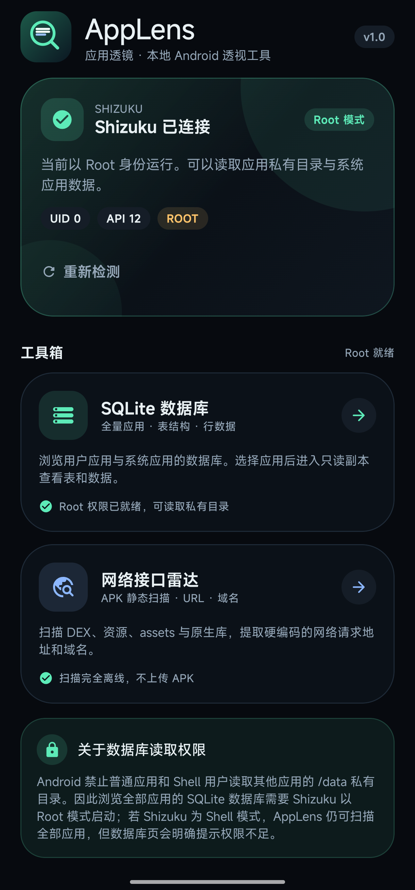
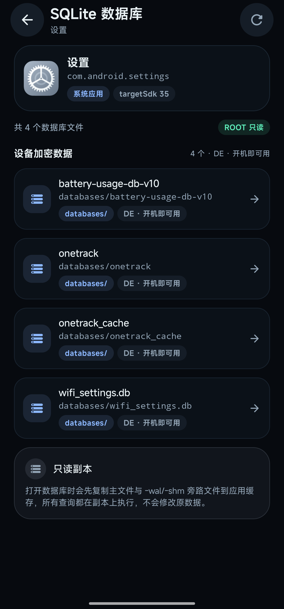
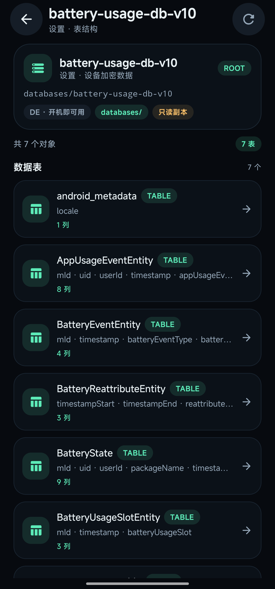

# AppLens 应用透镜

[](https://github.com/caochuankuan/AppLens/actions/workflows/android.yml)
[Releases](https://github.com/caochuankuan/AppLens/releases)

一个本地运行的 Android 应用透视工具：通过 Shizuku 获取受控的系统级访问能力，浏览应用 SQLite 数据库，并静态扫描 APK 中的网络请求 URL。

> **只读、离线、不上传数据。** 所有解析都在设备本地完成。

## 功能

### 1. SQLite 数据库浏览器

- 展示全部已安装应用（含系统应用），支持搜索、用户/系统筛选。
- 选择应用后扫描应用数据目录中的常见 SQLite 文件（`databases/` 下的全部文件，以及其他目录下的 `.db/.sqlite/.sqlite3/.db3` 文件），覆盖：
  - `/data/user/0/<pkg>`（CE 应用私有数据）
  - `/data/user_de/0/<pkg>`（DE 设备加密数据）
  - `/storage/emulated/0/Android/data/<pkg>`（外部存储）
- 打开数据库时复制主文件及 `-wal` / `-shm` / `-journal` 到缓存，所有查询在只读副本上执行。
- 展示表与视图、列名/类型、分页浏览行数据（每页 100 行），点击单元格复制。
- 自动识别 SQLCipher 等非明文数据库并给出提示。

**Root 说明：** Android 不允许 Shell（UID 2000）读取其他应用的 `/data` 私有目录。因此“查看全部应用（含系统应用）的数据库”要求 Shizuku 以 **Root 模式**启动。AppLens 会检测 Shizuku 的 UID：

- UID 0：完整读取；
- UID 2000：仍可扫描 APK 与展示应用列表，数据库页会说明权限不足；对 `debuggable` 应用会尝试 `run-as` 回退。

### 2. 网络接口雷达（静态 URL 扫描）

- 选择应用后扫描其 base APK 与 split APK。
- 从以下内容中提取 `http://`、`https://`、`ws://`、`wss://` 完整 URL：
  - `classes*.dex`
  - `resources.arsc` / `AndroidManifest.xml`
  - `assets/`、`res/raw/`、`res/xml/` 中的文本
  - `lib/**/*.so` 原生库
- 去重并按域名聚合，展示来源文件、出现次数，支持搜索、按域名筛选、复制、分享。
- 过滤 w3.org / schemas.android.com 等常见非业务命名空间 URL。

**边界：** 这是静态扫描，不抓包。运行时拼接、加密、服务端下发、WebView 动态加载的 URL 不会被发现。AppLens 不会发起任何网络请求。

## 技术栈

- Kotlin 2.2.20 / Jetpack Compose Material 3
- Shizuku API 12.1.0（保留 `Shizuku.newProcess`）+ provider 13.1.5 + AIDL 13.1.5
- Android Gradle Plugin 8.13.2 / Gradle 8.14 / compileSdk 36 / minSdk 26 / targetSdk 35
- 包名 `com.applens.inspector`

## 构建

环境要求：JDK 17+、Android SDK（platform 36、build-tools 36.0.0）。

```bash
export GRADLE_USER_HOME=/path/to/writable/gradle-home
./gradlew :app:assembleDebug
```

APK 输出：`app/build/outputs/apk/debug/app-debug.apk`。

### Release 签名

签名信息不提交到仓库。复制示例文件并填入自己的 keystore：

```bash
cp keystore.properties.example keystore.properties
# 编辑 keystore.properties，填入 storeFile / storePassword / keyAlias / keyPassword
./gradlew :app:assembleRelease
```

如果仓库中不存在 `keystore.properties`，仍可构建未签名的 release APK。`keystore.properties`、`*.keystore`、`*.jks` 均已加入 `.gitignore`。

## 使用步骤

1. 安装 [Shizuku](https://shizuku.rikka.app/download/) 并启动服务。Root 设备可直接在 Shizuku 内点击“启动”；非 Root 设备需通过无线调试/ADB 启动。
2. 打开 AppLens。首次打开会自动弹出 Shizuku 授权请求；若错过，可点击首页的“请求授权”。
3. 在 MIUI / HyperOS 上，进入应用列表时还需允许“获取应用列表”权限（AppLens 会展示说明与请求按钮）。
4. 首页出现两个功能入口：
   - SQLite 数据库
   - 网络接口雷达
5. 选择应用进入对应页面。

## 权限

- `QUERY_ALL_PACKAGES`：展示全部应用。
- `com.android.permission.GET_INSTALLED_APPS`：MIUI / HyperOS 额外的“获取应用列表”运行时权限。
- Shizuku provider 使用 `android.permission.INTERACT_ACROSS_USERS_FULL` 保护，由 Shizuku 应用访问。
- 应用不申请网络权限，也不申请存储权限。

## 界面预览

| 首页 | 数据库 | 表结构 |
| --- | --- | --- |
|  |  |  |

## 安全与合规

- 本项目仅用于**自己拥有或已获得明确授权**的设备与应用。
- 不要用它读取、传播他人的隐私数据；请遵守当地法律及目标应用的服务条款。
- AppLens 与 Shizuku 官方无隶属关系。
- 如发现安全问题，请通过 GitHub Security Advisories 私下报告，不要在公开 issue 中粘贴敏感数据。

## 已知限制

- 非 Root 的 Shizuku 无法读取其他应用私有目录，这是 Android 权限模型限制，不是应用 bug。
- 少数数据库使用 SQLCipher/自定义加密，无法直接读取。
- 数据库在复制瞬间可能正被写入；副本可能缺少最新事务，但不会影响原库。
- 静态 URL 扫描无法覆盖运行时动态生成的地址。
- 部分厂商系统可能限制 `run-as` 或对 `/data/user_de` 有额外 SELinux 策略。


## License

[MIT](LICENSE)
